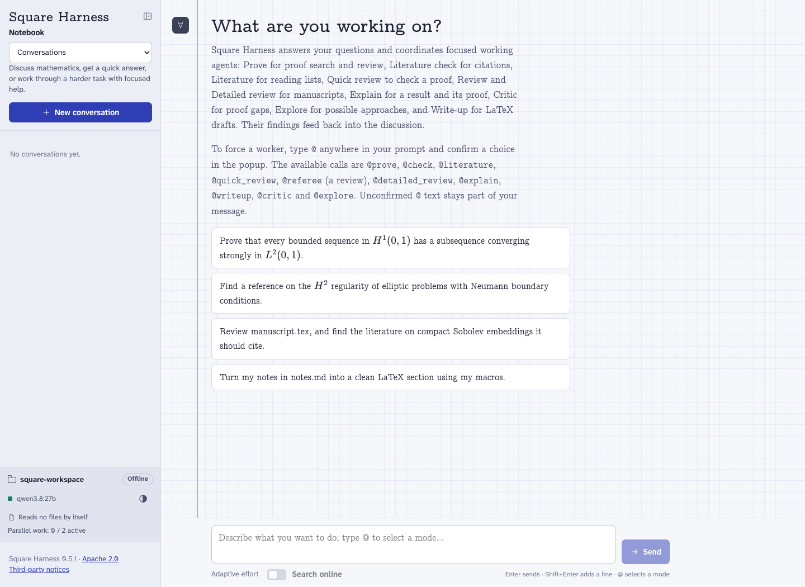

# Square Harness

**A source-available harness for mathematical research, using local or API
model providers.**

Square Harness turns a language model into a research assistant for
mathematics. Its core is a simple proof workflow, **solve → verify → repair
when needed**. It keeps the original answer, reviews the complete proof, and
saves every candidate and objection for inspection. The same principles serve
literature checks, reading lists, manuscript reviews, explanations, LaTeX
write-ups and numerical experiments.

**Version 1.1.0. One Docker image, for local use or your own server.** The app
does not need a separate Python or Node.js installation. Docker is required;
the model itself is not included in the image.

<picture>
  <source media="(prefers-color-scheme: dark)" srcset="https://raw.githubusercontent.com/Square-Harness/Square-Harness/main/docs/images/interface-dark.png">
  
</picture>

## Quick start: run locally with Docker

1. Install [Docker Desktop](https://www.docker.com/products/docker-desktop/) on
   Windows or macOS, or Docker Engine with the Compose plugin on Linux. Start
   Docker Desktop/Engine.
2. [Download the source ZIP](https://github.com/Square-Harness/Square-Harness/archive/refs/heads/main.zip)
   and extract it.
3. From the extracted project folder (usually named `Square-Harness-main`),
   run the launcher:

   **macOS or Linux**
   ```bash
   bash deployment/start-local.sh
   ```

   **Windows PowerShell**
   ```powershell
   powershell.exe -NoProfile -ExecutionPolicy Bypass -File .\deployment\start-local.ps1
   ```

The launcher checks Docker and Compose, builds the app image from the downloaded
source on first run, starts it in local mode, and opens the private app link in
your browser. It does **not** install Docker automatically: Docker installation
requires operating-system-specific steps and your approval. The image is not
currently published as a prebuilt download. Python and Node.js are not needed.
The PowerShell command's execution-policy bypass applies only to that
PowerShell process; it does not change your system policy.

The app and its saved workspace data remain in Docker. To stop the app without
deleting data, run this from the extracted folder:

```sh
docker compose --env-file deployment/compose.local.env.example down
```

### Change or create a workspace

The current workspace folder is shown above the message box. Click its name to
open the folder browser. Select a folder and choose **Open this folder**, or
enter a name and choose **Create folder here**, then open the new folder.
Pause running work and clear queued turns before switching. Each folder keeps
its own conversations and saved jobs.

In the Docker setup, these folders live inside Square Harness's persistent
Docker data volume; the initial folder is named `default`. The browser does not
provide access to arbitrary folders on your computer; add files through the app
or use a native installation if you need to work directly in existing computer
folders.

### Choose and configure a model

The app image does not include or start a model. Choose a provider that the
Docker container can reach, or run a model server separately. In the app, open
**Model provider** in the sidebar and set:

1. **Provider** — select the service you use.
2. **Endpoint URL** — the provider's API base URL.
3. **Model name** — the exact model identifier accepted by that provider.
4. **API key** — enter the key supplied by your provider, if required, then
   choose **Save provider**.

The key is sent to the app backend and is never returned to the browser or
written into conversations. It is session-only by default. In local mode,
**Remember API key on this computer** saves it in a permission-restricted file
inside Docker's persistent data volume; this is not encryption, so protect the
computer and its Docker data/backups. Prompts and selected research material are
sent to the chosen model provider; check that provider's data and retention
terms.

### Deploy on your own server

The same app image supports server mode, but a server deployment also needs a
trusted authentication gateway, persistent storage, and a provider-origin
allowlist. Do not expose the app container directly to the internet. Follow
[the Docker server setup](docs/llm-install.md#run-the-full-app-in-docker).
Server API keys are session-only by default; persistent **Remember** requires an
operator-configured managed secret store. See the [user guide](docs/guide.md)
and [full installation guide](docs/llm-install.md) for provider and server
details.

For native Python/terminal use, remote GPU setups, or advanced model hosting,
see the [installation guide](docs/llm-install.md).

### Use Square Harness on Android

There is no native Android APK; the app is a Progressive Web App (PWA). The
local Docker launcher publishes only on your computer's loopback address, so it
cannot be opened from your phone. Deploy the app in server mode behind an
HTTPS-enabled, authenticated gateway first. Then on Android:

1. Open the server's HTTPS app address in Chrome and sign in.
2. Open Chrome's **⋮** menu and choose **Install app** or **Add to Home screen**.
3. Confirm, then launch Square Harness from the new home-screen icon.

The installed PWA still needs a network connection to reach the server and model
provider for agent work. Offline, it can show only the cached app interface;
conversations, credentials and workspace data are not cached on the phone.
Server-side workspaces and provider-key storage remain on the server.

## What it does

- **Conversations**: ask in plain words. The Assistant answers, or starts
  focused jobs and reads their results before continuing.
- **Prove**: solve, verify and repair, with every attempt kept.
- **Literature check**: references with an evidence level (read, cited,
  located, contradicted, not found).
- **Reading lists**: built from verified records.
- **Reviews**: a quick check of a proof, a referee report, a detailed review that
  also checks the proofs, and step-by-step explanations.
- **Write-ups**: LaTeX in your own style (a template, or a style learnt from your
  articles), with numbered equations and checked references.
- **Python Lab and Sanity check**: run in a Docker sandbox.
- **Projects**: private saved conversations, project notes and research files.

Every job has a bounded budget, can be paused and resumed, and saves what the
model saw and wrote under `.mathagent/` in its workspace. The Docker quick start
keeps that workspace in a persistent Docker volume. The app container does not
mount the Docker socket, so Python Lab and Sanity check are unavailable in this
Docker setup; they are available in a native installation with Docker. To use
the app on a phone, deploy it behind HTTPS; its PWA caches only the interface,
not conversations or offline model access. The [guide](docs/guide.md) explains
each skill and how it is built.

## Documentation

- [Guide](docs/guide.md): philosophy, every skill, how skills are made, effort,
  data and privacy.
- [Install guide](docs/llm-install.md): Docker quick start, native installation,
  remote GPU/cluster setup and server deployment.
- [Development guide](docs/llm-development.md): architecture, rules, how to add a
  feature, benchmarks.
- [Changelog](CHANGELOG.md).

Ollama, llama.cpp, vLLM and MLX servers, plus API providers, are supported.
Solver and verifier calls use separate contexts, keeping the original
statement, candidate and review.

## Contributing and license

Created by **Vincent Boulard**, with **Louis Carillo**. See
[CONTRIBUTING.md](CONTRIBUTING.md) and [CITATION.cff](CITATION.cff). Maintainers
decide which contributions are merged.

[PolyForm Noncommercial License 1.0.0](LICENSE.md): free use, modification and
redistribution for noncommercial purposes, including personal research and use
by universities and public research organisations. Commercial use requires a
separate license from the relevant copyright holders.
Model weights, dependencies and retrieved papers retain their own licenses.
See [NOTICE](NOTICE) for attribution.
