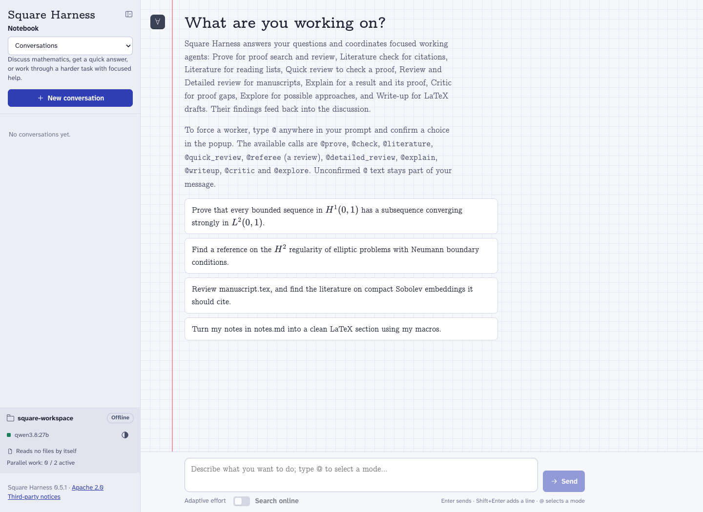

# Square Harness

**A source-available harness for mathematical research with open-weights models.**

Square Harness turns a language model running on your computer, or on a GPU in
your lab, into a research assistant for mathematics. Its core is a simple proof
workflow, **solve → verify → repair when needed**. It keeps the original answer,
reviews the complete proof, and saves every candidate and objection for
inspection. Around it, the same principles serve literature checks, reading
lists, manuscript reviews, explanations, LaTeX write-ups and numerical
experiments.

**Version 1.1.0. Self-host first.** Run the model, harness and workspace on your own
computer or research server. This setup needs no model-provider API key.

<picture>
  <source media="(prefers-color-scheme: dark)" srcset="https://raw.githubusercontent.com/Square-Harness/Square-Harness/main/docs/images/interface-dark.png">
  
</picture>

## Quick start

Choose where your model runs:

| Route | Setup | Guide |
| --- | --- | --- |
| **1. Local self-hosting** | Run the model on your computer with Ollama, or another local model server. | [Plan A](docs/llm-install.md#plan-a-local-model) |
| **2. Remote GPU or cluster** | Self-host the model on a lab/remote GPU and connect SH through SSH. | [Plan B](docs/llm-install.md#plan-b-model-on-a-cluster-gpu-reached-by-ssh) |
| **3. API trial only** | Test SH without a GPU using DeepInfra and a provider API key; selected inputs are sent to the provider. | [Plan C](docs/llm-install.md#plan-c-deepinfra-api-with-a-local-interface) |

**The API route is an optional testing setup.** Local and remote self-hosting
remain the intended ways to run SH with control over the model and research data.

Ask a coding agent (Claude Code, Codex, …) in a terminal:

```text
Install Square Harness following https://github.com/Square-Harness/Square-Harness/blob/main/docs/llm-install.md
```

For local self-hosting by hand, use Python 3.10+ on Linux or macOS with
[Ollama](https://ollama.com) running:

```bash
git clone https://github.com/Square-Harness/Square-Harness.git
cd Square-Harness
python3 -m venv .venv
.venv/bin/python -m pip install -e '.[research]'
ollama pull qwen3.8:27b
mkdir -p ~/research/square-workspace
.venv/bin/square-harness --gui --workspace ~/research/square-workspace
```

Your browser opens on the web app. Without `--gui`, the same harness runs in the
terminal:

```text
/prove Prove that every bounded sequence in H¹(0,1) has a subsequence converging strongly in L²(0,1).
/proofs
/proof-report
```

`qwen3.8:27b` (18 GB) with the default 40,960-token context needs a large GPU or
Mac. For smaller machines and other model servers, see the
[install guide](docs/llm-install.md).

## What it does

- **Conversations**: ask in plain words. The Assistant answers, or starts
  focused jobs and reads their results before continuing.
- **Prove**: solve, verify and repair, with every attempt kept.
- **Literature check**: references with an evidence level (read, cited,
  located, contradicted, not found).
- **Reading lists**: built from verified records.
- **Reviews**: a quick check of a proof, a referee report, a detailed review that
  also checks the proofs, and step-by-step explanations.
- **Write-ups**: LaTeX in your own style (a template, or a style learnt from your
  articles), with numbered equations and checked references.
- **Python Lab and Sanity check**: run in a Docker sandbox.
- **Projects**: private saved conversations, project notes and research files.

Every job has a bounded budget, can be paused and resumed, and saves what the
model saw and wrote under `.mathagent/` in your folder. The web app runs locally,
also works on a phone, and shares its jobs with the terminal. The
[guide](docs/guide.md) explains each skill and how it is built.

## Documentation

- [Guide](docs/guide.md): philosophy, every skill, how skills are made, effort,
  data and privacy.
- [Install guide](docs/llm-install.md): local self-hosting, remote GPU/cluster,
  and the optional API trial, written for a coding agent.
- [Development guide](docs/llm-development.md): architecture, rules, how to add a
  feature, benchmarks.
- [Changelog](CHANGELOG.md).

Ollama, llama.cpp, vLLM and MLX servers are supported. Solver and verifier calls
use separate contexts, keeping the original statement, candidate and review.

## Contributing and license

Created by **Vincent Boulard**, with **Louis Carillo**. See
[CONTRIBUTING.md](CONTRIBUTING.md) and [CITATION.cff](CITATION.cff). Maintainers
decide which contributions are merged.

[PolyForm Noncommercial License 1.0.0](LICENSE.md): free use, modification and
redistribution for noncommercial purposes, including personal research and use
by universities and public research organisations. Commercial use requires a
separate license from the relevant copyright holders.
Model weights, dependencies and retrieved papers retain their own licenses.
See [NOTICE](NOTICE) for attribution.
